# 내 문서 검색 (MyDocSearch)

**흩어진 내 업무 문서를 이 PC 안에서 바로 찾고, 내 Claude·ChatGPT 구독으로 근거가 달린 답·표·보고서 초안까지 만드는 Windows 앱입니다.**

내 PC의 폴더(문서·바탕 화면·다운로드·OneDrive)를 읽어 **PC 안에** 검색 색인을 만듭니다.
기본 검색은 인터넷을 쓰지 않으며 파일 내용은 PC 밖으로 나가지 않습니다.

| | |
|---|---|
| 🔎 **찾기** | 파일 이름 + 한글(HWP·HWPX)·PDF·워드·파워포인트·엑셀 본문, 압축 파일 속 문서까지 0.2초 |
| 🧭 **뜻으로 찾기** | 질문에 그 단어가 없어도 뜻이 비슷한 문서, 사진·영상도 이름이 아니라 내용으로 |
| 💬 **묻기** | 내 구독 AI가 문서를 직접 찾아 읽고 답, 근거를 누르면 원문의 그 쪽·셀에 형광펜 |
| ✅ **맞춰 보기** | 점검표 대조(항목마다 ✅·⚠️·❌), 최종·최최종 버전 묶기와 비교 |
| 🗂 **모으고 쓰기** | 모음(가상 폴더) → 주간업무보고·결과보고서 초안을 워드로, 루틴으로 정해진 시각에 자동 |
| 🔒 **지키기** | 색인은 PC 안에만, 민감 정보 문서는 AI에게 보내지 않음, AI에 보낸 내역 기록 |

**바로 가기**: [받기](#받기-windows-1011-64비트) · [기능 소개](#기능-소개) · [설정 사용법](#설정-사용법) · [새 버전·지우기](#새-버전으로-바꾸기--지우기) · [개인 정보](#개인-정보)

> 아래 화면은 모두 시험용 가상 문서로 찍었습니다.

---

## 받기 (Windows 10/11 64비트)

1. [**Releases**](https://github.com/JinyoungPark/MyDocSearch/releases/latest)에서 `MyDocSearch-0.2.0-windows-portable.zip`(약 200MB)을 받습니다.
2. 원하는 곳(예: `D:\Apps\MyDocSearch`)에 **압축을 모두 풉니다**. 설치는 필요 없습니다.
3. 폴더 안의 `MyDocSearch.exe`를 실행합니다. “Windows의 PC 보호” 창이 뜨면 **추가 정보 → 실행**.
4. 첫 화면에 문서·바탕 화면·다운로드(OneDrive가 있으면 함께)가 골라져 있습니다 → **이 폴더로 시작**.
   색인하는 동안에도 바로 찾을 수 있습니다.

- **AI 답을 받으려면**: 설정 → 💬 AI·보안에서 Claude(Pro·Max) 또는 ChatGPT(Plus 이상)에 로그인합니다. API 키는 필요 없습니다.
- **필요한 것**: 디스크 여유 1GB 이상 (의미 검색 모델을 쓰면 +0.5~2GB).

---

## 기능 소개

### 1. 이름과 본문을 한 번에, 0.2초

검색어를 넣으면 파일 이름·폴더 이름·본문을 함께 찾습니다. 결과를 누르면 오른쪽에 **원본 모양 그대로** 열리고 찾은 곳에 형광펜이 칠해집니다.

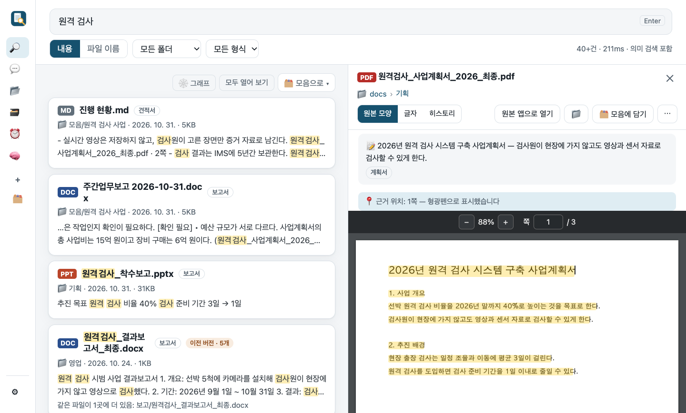

- 지원 형식: PDF, 한글(HWP·HWPX), 워드(DOCX·DOC), 파워포인트(PPTX·PPT), 엑셀(XLSX), 텍스트·마크다운·CSV, RTF
- **압축 파일(zip) 속 문서**도 하나하나 찾습니다 (`자료.zip › 폴더/파일.pdf`)
- 조사를 떼고 찾고(“원격검사의” → “원격검사”), 같은 파일 사본은 한 묶음으로
- **파일 이름으로 찾기**: `*`·`?` 와일드카드, `.dwg` 확장자, `폴더/이름` 경로. 전체 경로 복사
- 말로 거르기: “지난달 받은 엑셀 중 견적”, “올해 한빛소프트 견적서”
- 스캔본 PDF는 글자 인식(OCR, 선택)으로 본문까지
- 바뀐 파일만 다시 읽는 자동 색인(켤 때 + 15분~4시간마다). OneDrive “필요할 때 다운로드” 파일은 내려받지 않고 이름만

### 2. 다른 말로 물어도, 뜻으로 찾는다 (선택)

“선박에 직접 가지 않는 점검”으로 찾으면, 그 말이 없는 **원격검사 사업계획서**가 맨 위에 나옵니다.

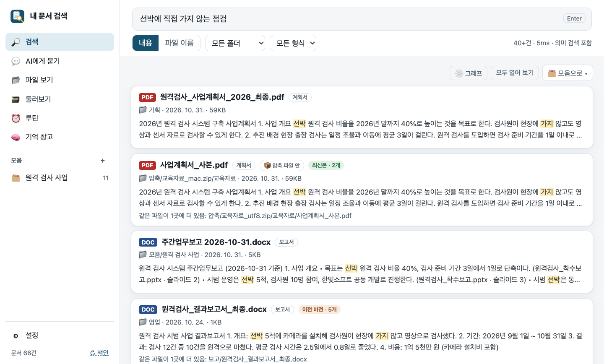

- 설정 → 의미 검색을 켜고 모델을 고릅니다: **기본**(빠름) 또는 **정확**(Google EmbeddingGemma 2)
- 모델은 처음 한 번 받고, 그 뒤로는 **인터넷 없이 PC 안에서** 돌아갑니다
- 그래픽 장치(NVIDIA·AMD·인텔)가 있으면 CPU와 속도를 재 보고 더 빠를 때만 자동으로 씁니다

### 3. 사진·영상도 내용으로 찾는다 (선택)

파일 이름이 `IMG_1080.jpg`뿐이어도 “바닷가 사진”, “해안 절벽 영상”으로 찾고, 영상은 그 장면에서 바로 재생합니다.

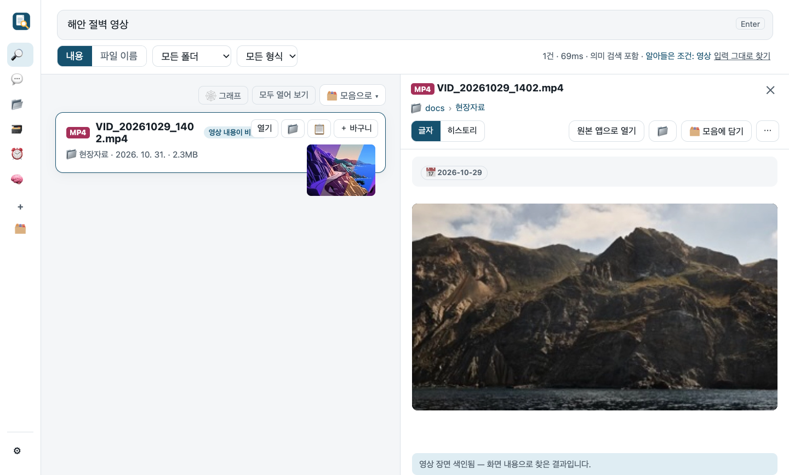

### 4. AI가 찾아 읽고 답하고, 근거까지 보여 준다

“원격 검사 영상 자료는 어디에 저장해? 견적 합계와 납품 기한도”처럼 물으면, **내 구독 AI(Claude 또는 ChatGPT)가 직접 문서를 검색하고 읽어** 답합니다.
답의 근거 링크를 누르면 원문의 **그 쪽·슬라이드·엑셀 셀**이 강조됩니다.

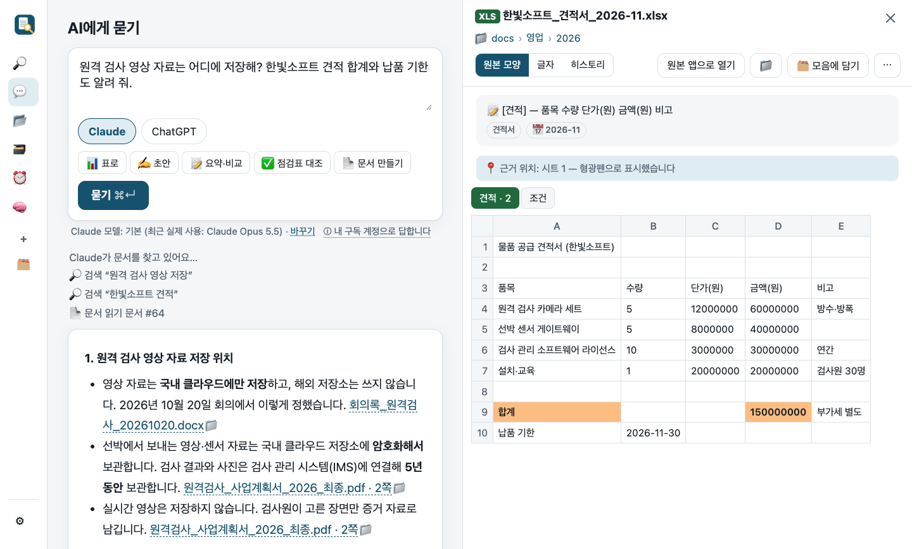

- 내 구독 계정으로 로그인 — API 키·별도 요금 없음
- 모델을 고를 수 있고, 답 아래에 실제로 쓴 모델을 표시
- 답을 **표로 · 요약 · 비교** 하거나 **워드로 저장**
- **민감 정보 보호**: 주민번호·카드번호·비밀번호·여권번호·API 키가 보이는 문서는 AI에게 보내지 않고, 폴더마다 ‘AI가 읽을 수 있음’을 끌 수 있습니다. AI에 보낸 문서는 ‘AI 전송 내역’에 남습니다

### 5. 점검표 대조: 반나절 맞춰 보던 일을, 근거 달린 1분짜리 결론으로

기준 문서(규정·요구사항·점검 기준)와 대상(모음·AI 바구니·모든 문서)만 고르면, 항목마다 **✅ 충족 · ⚠️ 확인 필요 · ❌ 없음** 표를 만듭니다.
칸마다 근거 링크가 달리고, 표 아래에 보완할 일과 충족률이 나옵니다.

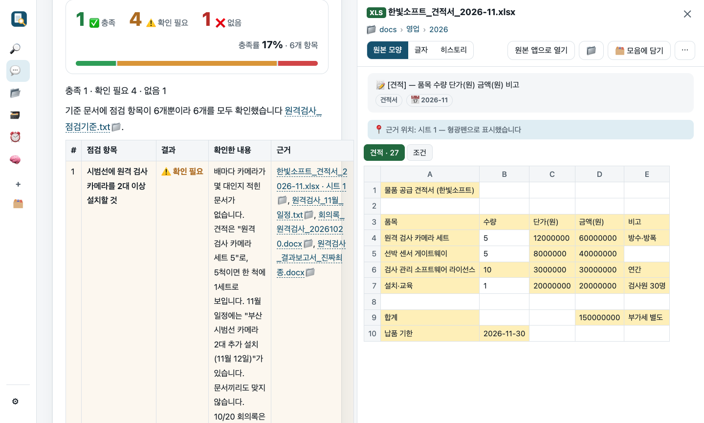

- 문서끼리 숫자가 다르면(예: 견적 1억 5천만 · 보고서 1억 4천 2백만) AI가 먼저 ⚠️로 짚습니다
- 결과는 워드·CSV(엑셀)로 저장

### 6. 최종? 최최종? — 버전을 묶고, 바뀐 곳을 보여 준다

`초안 · 최종 · 최종_수정 · 진짜최종`을 한 묶음으로 잡아 **최신본** 하나만 표시하고, 다른 폴더의 같은 파일은 “1곳에 더 있음”으로 묶습니다.
**버전 비교**로 지운 문장은 빨강, 더한 문장은 초록으로 보고, **정리 후보**에서 내용이 같은 파일들을 모아 봅니다 (지우지 않고 보여만 줍니다).

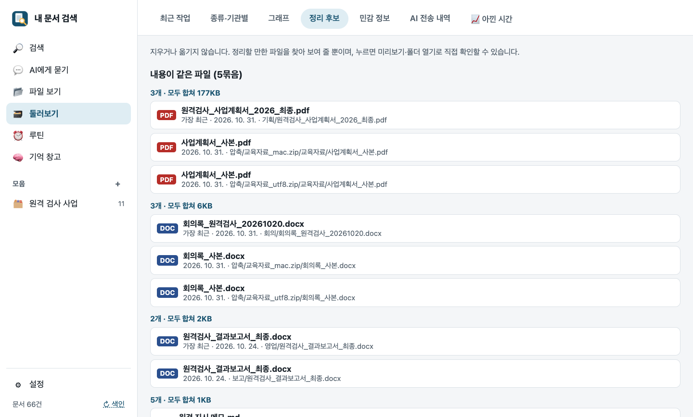

- **그래프**: 문서 사이 관계를 마디와 줄로 — 비슷한 내용(회색), 같은 문서의 버전(주황), 같은 회사·기관
- **파일 히스토리**: 만든 사람, 바뀐 기록과 바뀐 내용, 내려받은 곳

### 7. 모으고, 쓰고, 알아서 돌게

- **모음 (가상 폴더)**: 흩어진 관련 파일을 옮기지 않고 앱 안에서 모아 봅니다. 검색 조건으로 만들면 새 파일이 저절로 들어옵니다
- **새 문서 만들기**: 모음의 문서와 회사 서식 파일로 주간업무보고·중간보고서·결과보고서·회의록 초안을 쓰고 **워드로 저장** — 서식 파일의 스타일·머리말을 그대로 유지, 문장마다 근거
- **루틴**: “매주 금요일 17시 주간업무보고”, “새 문서가 들어오면 진행 현황 고쳐 쓰기”처럼 정해진 때에 AI가 보고서를 씁니다. 노션에도 올릴 수 있고, 앱을 닫아도 돌게 할 수 있습니다
- **기억 창고**: Claude Code·Codex·ChatGPT·claude.ai에서 일한 기록을 가져와 주제별 위키로 정리 (비밀값은 가림)

### 8. 아낀 시간 계기판

앱이 대신 한 일(찾기·AI 답·점검표 대조·문서 만들기…)의 횟수 × 1번에 아낀 시간 = **아낀 시간**. 날마다 막대, 발표용 요약 복사.
1번에 아낀 시간은 회사 기준에 맞게 고칠 수 있고, 검색어·문서 내용은 남기지 않고 횟수만 셉니다.

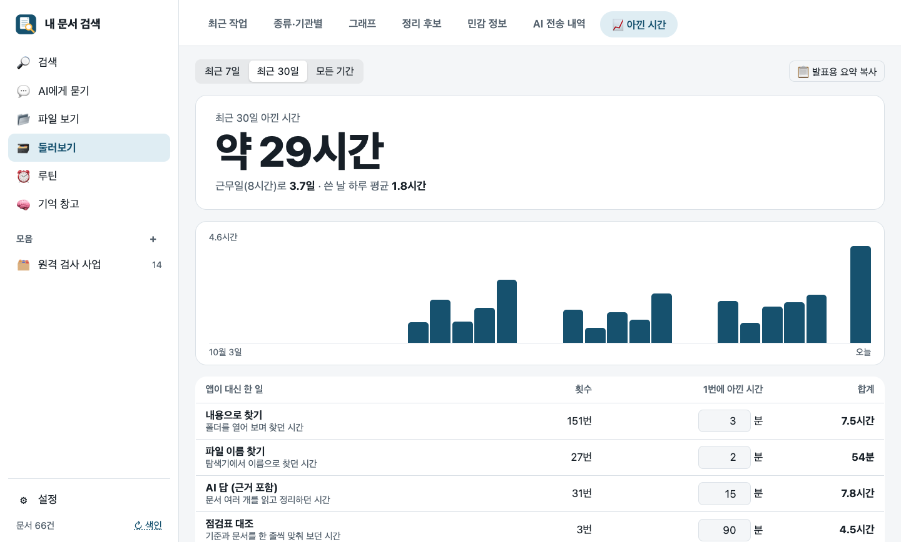

### 9. 다른 AI 앱에서도 내 문서를

설정 → AI·보안 → ‘다른 AI 앱에서 내 문서 쓰기’의 **연결** 버튼 하나로 **Claude 데스크톱 · Claude Code · Codex**에 내 문서 검색 도구(MCP)를 붙입니다.
그 앱에서 “내 PC에서 ○○ 찾아서 정리해 줘”라고 하면 이 앱의 색인으로 찾아 근거와 함께 답합니다.
지금 실행 중인 위치로 등록하며, 앱 폴더를 옮기면 ‘다시 연결’이 뜹니다.

---

## 설정 사용법

왼쪽 목록 맨 아래 **⚙ 설정**을 누르면 네 부분으로 나뉜 설정 창이 열립니다. 고친 뒤 맨 아래 **저장하고 색인**을 누르면 적용됩니다.

**📁 폴더·색인** · **🔎 검색 기능** · **💬 AI·보안** · **ℹ️ 정보** — 아래 그림의 번호와 설명 번호가 같습니다.

> 설정 화면은 시험용 데이터로 찍었고, 폴더·앱 위치는 Windows 예시 경로로 바꿔 보여 드립니다.

### 처음 쓰는 분께 권하는 설정

| 하고 싶은 것 | 설정 |
|---|---|
| 그냥 빨리 찾기 | 처음 화면의 **이 폴더로 시작**만 누르면 끝. 그대로 두세요 |
| 회사 공유 폴더·D 드라이브 자료도 | 📁 폴더·색인 → 검색할 폴더에 **추가** |
| 말을 바꿔 물어도 찾게 | 🔎 검색 기능 → **의미 검색 사용** → 모델 **기본** (메모리 16GB 이상이면 **정확**) |
| 스캔본 PDF도 찾게 | 🔎 검색 기능 → **글자 인식(OCR)** 켜기 |
| AI에게 묻기 | 💬 AI·보안 → AI 연결에서 **Claude** 또는 **ChatGPT 로그인** |
| Claude 데스크톱에서 내 문서 쓰기 | 💬 AI·보안 → 다른 AI 앱에서 내 문서 쓰기 → **연결** |

### 📁 폴더·색인

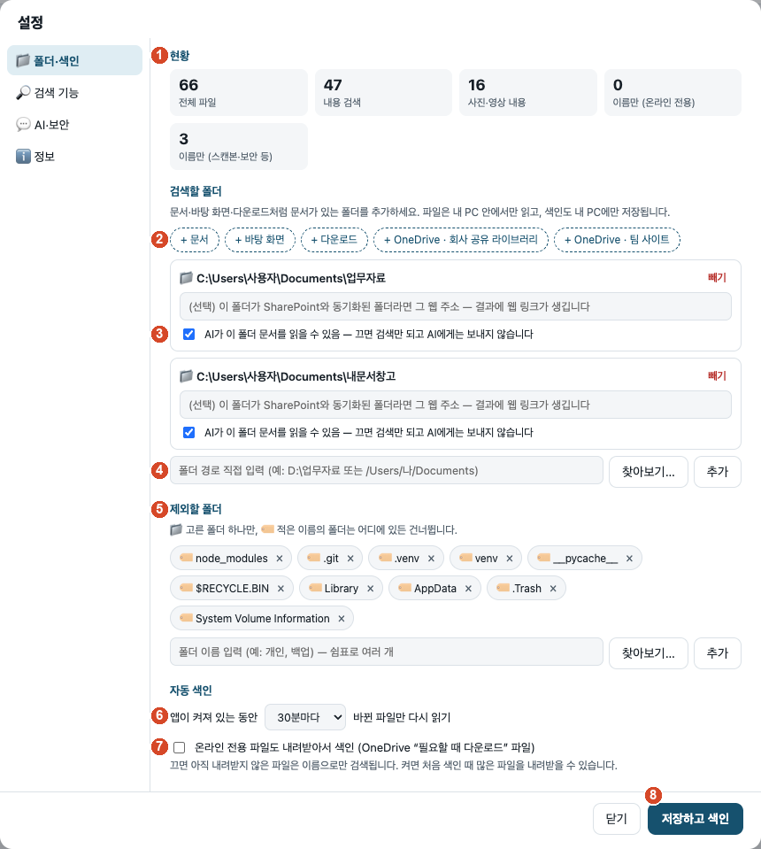

1. **현황**: 전체 파일 수, 본문까지 찾을 수 있는 파일, 사진·영상 내용, 이름만 찾는 파일(온라인 전용 · 스캔본·보안 문서).
2. **빠른 추가**: `+ 문서` `+ 바탕 화면` `+ 다운로드` `+ OneDrive …`를 누르면 그 폴더가 바로 들어갑니다. 이 PC에서 찾은 OneDrive·SharePoint 동기화 폴더도 여기에 나옵니다.
3. **검색할 폴더**: 폴더마다 카드 하나.
   - **AI가 이 폴더 문서를 읽을 수 있음**을 끄면 그 폴더 문서는 검색만 되고 AI에게는 보내지 않습니다 (인사·급여 폴더 등).
   - 위 칸에 SharePoint 웹 주소를 적으면 검색 결과에 웹 링크가 생깁니다 (선택). **빼기**로 목록에서 뺍니다 (원본은 그대로).
4. **폴더 직접 추가**: 경로(예: `D:\업무자료`)를 적거나 **찾아보기…** 버튼으로 고른 뒤 **추가**. 드라이브 전체(`D:\`)도 되지만 처음 색인이 오래 걸립니다. `Windows`·`Program Files` 같은 시스템 폴더는 항상 건너뜁니다.
5. **제외할 폴더**: 이름(예: `백업`, `개인`)을 적으면 그 이름의 폴더는 어디에 있든 건너뜁니다. **찾아보기…** 버튼으로 고르면 그 폴더 하나만 뺍니다. `node_modules`·`AppData`·휴지통 같은 폴더는 처음부터 빠져 있습니다.
6. **자동 색인**: 앱이 켜져 있는 동안 **15분 · 30분(기본) · 1시간 · 4시간마다** 바뀐 파일만 다시 읽습니다. 앱을 켤 때도 한 번 읽습니다.
7. **온라인 전용 파일도 내려받아서 색인**: OneDrive “필요할 때 다운로드” 파일까지 본문을 읽습니다. 끄면(기본) 이름으로만 찾고, 켜면 처음 색인 때 많은 파일을 내려받을 수 있습니다.
8. **저장하고 색인**: 바꾼 설정을 저장하고 바로 색인을 시작합니다. **닫기**는 저장하지 않고 닫습니다.

### 🔎 검색 기능

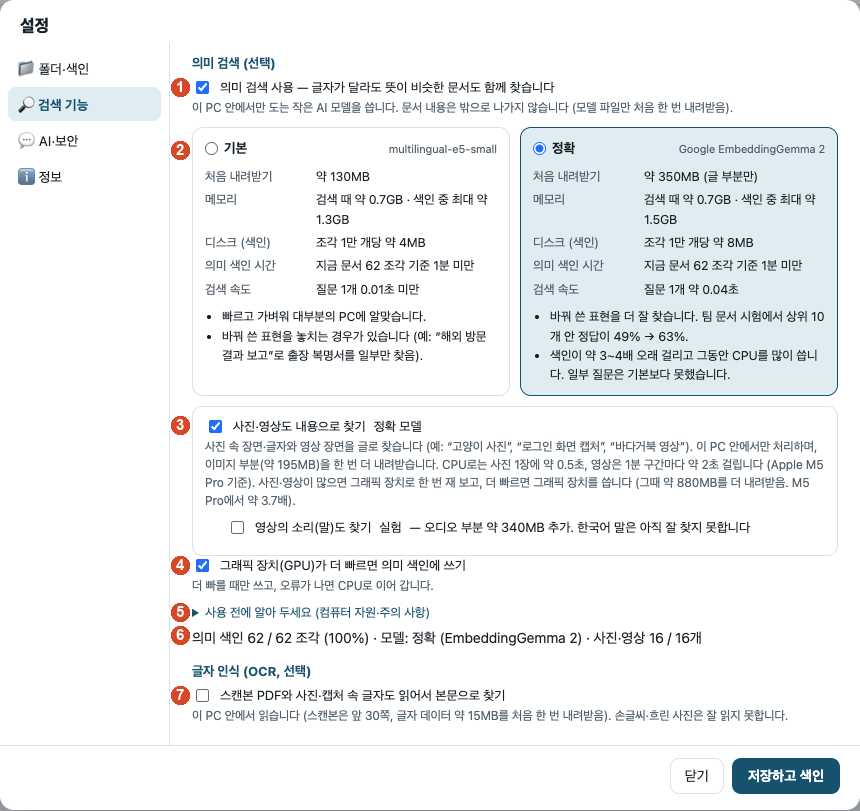

1. **의미 검색 사용** (선택): 글자가 달라도 뜻이 비슷한 문서를 함께 찾습니다. 이 PC 안에서만 도는 작은 AI 모델이라 문서는 밖으로 나가지 않습니다 (모델 파일만 처음 한 번 내려받음).
2. **모델 고르기**: 카드마다 내려받을 크기, 메모리, 지금 문서 양 기준 예상 색인 시간이 나옵니다.

   | | 기본 (multilingual-e5-small) | 정확 (Google EmbeddingGemma 2) |
   |---|---|---|
   | 처음 내려받기 | 약 130MB | 약 350MB |
   | 메모리 | 검색 때 약 0.7GB, 색인 중 최대 약 1.3GB | 검색 때 약 0.7GB, 색인 중 최대 약 1.5GB |
   | 잘 맞는 PC | 대부분의 PC | 메모리 16GB 이상, 바꿔 쓴 표현을 더 잘 찾음 |
   | 색인 시간 | 기준 | 약 3~4배 |

   모델을 바꾸면 의미 색인만 처음부터 다시 만듭니다 (단어 검색은 그대로).
3. **사진·영상도 내용으로 찾기** (정확 모델일 때): 사진 속 장면·글자와 영상 장면을 글로 찾습니다. 이미지 부분 약 195MB를 더 받습니다. ‘영상의 소리(말)도 찾기’는 실험 기능입니다.
4. **그래픽 장치(GPU)가 더 빠르면 의미 색인에 쓰기** (기본 켬): 처음 한 번 CPU와 그래픽 장치(NVIDIA·AMD·인텔)의 속도를 재 보고 더 빠를 때만 씁니다. 오류가 나면 CPU로 이어 갑니다.
5. **사용 전에 알아 두세요**: 펼치면 권장 사양과 주의 사항이 나옵니다.
   - 메모리 8GB 이상 권장. **처음 의미 색인은 수십 분~수 시간** 걸리니 노트북은 전원을 연결해 두세요. 중간에 꺼도 다음에 이어서 합니다.
   - 의미 색인이 끝나기 전에도 단어 검색은 그대로 됩니다.
   - 회사망에서 huggingface.co 접속이 막혀 있으면 모델을 받지 못합니다 (단어 검색만 동작).
6. **의미 색인 현황**: 몇 조각까지 끝났는지, 쓰는 모델, 사진·영상 수. 색인 중에는 어떤 장치로 계산하는지(“계산: 그래픽 장치 GPU 1(DirectML)” 등)도 나옵니다.
7. **글자 인식 (OCR)** (선택): 스캔본 PDF(앞 30쪽)와 사진·캡처 속 글자를 읽어 본문으로 찾습니다. 글자 데이터 약 15MB를 처음 한 번 받습니다. 손글씨·흐린 사진은 잘 읽지 못합니다.

### 💬 AI·보안

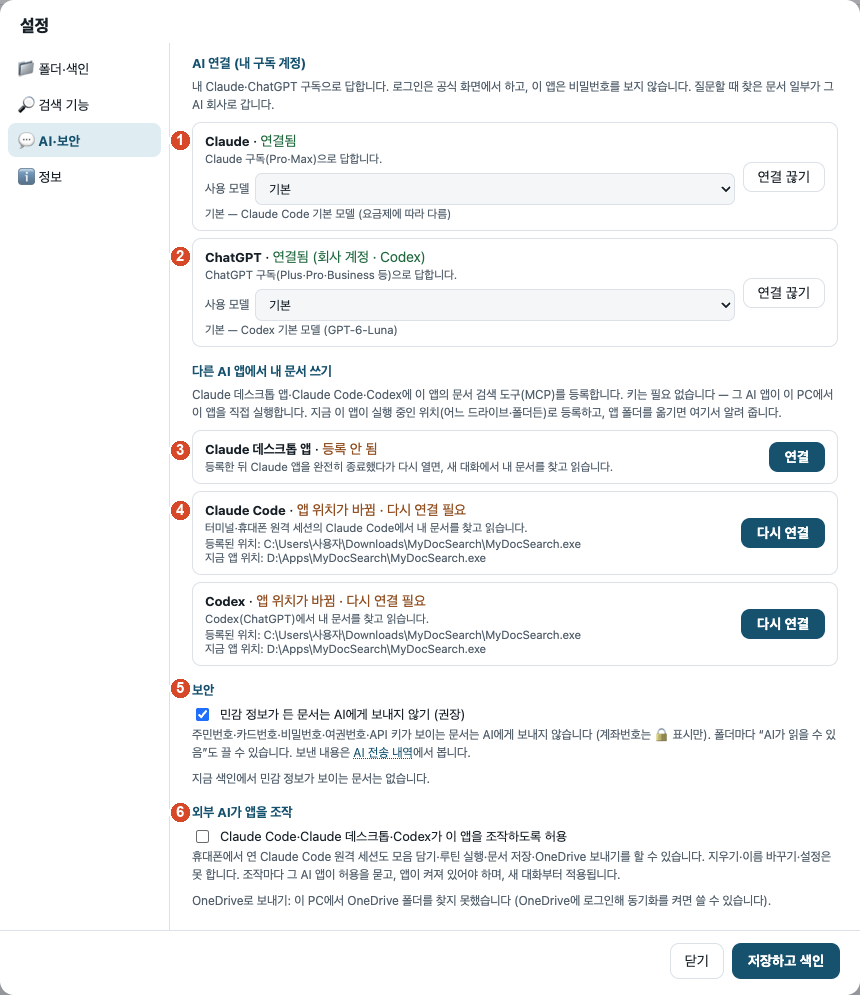

1. **Claude** (Pro·Max): **로그인** → 앱이 공식 Claude Code를 뒤에서 설치하고 브라우저에 로그인 화면을 띄웁니다 → 승인 뒤 나오는 코드를 앱 입력칸에 붙여 넣으면 **연결됨**.
   **사용 모델**에서 모델을 고릅니다 (‘기본’은 요금제에 맞는 모델).
2. **ChatGPT** (Plus 이상, 회사 Business 계정도): **로그인** → 브라우저의 OpenAI 공식 화면에서 승인하면 끝.
   - **연결 끊기**는 이 앱에서만 그 AI를 쓰지 않게 합니다. 이 PC의 다른 프로그램과 함께 쓰는 로그인까지 지우려면 끊긴 상태에서 **이 PC에서 완전히 로그아웃**.
   - 질문할 때 질문과 AI가 읽은 문서 일부가 그 AI 회사로 갑니다. 이 앱은 비밀번호를 보지 않습니다.
3. **다른 AI 앱에서 내 문서 쓰기 → 연결**: 이 PC에 설치된 **Claude 데스크톱 · Claude Code · Codex**가 보이고, **연결**을 누르면 이 앱의 문서 검색 도구(MCP)가 등록됩니다. 키는 필요 없습니다.
   Claude 데스크톱은 등록 뒤 앱을 완전히 종료했다가 다시 켜야 합니다.
4. **앱 위치가 바뀜 · 다시 연결 필요**: 앱 폴더를 옮기면(예: 다운로드 → `D:\Apps`) 등록된 위치와 지금 위치가 다르다고 알려 줍니다. **다시 연결**을 누르면 지금 위치로 다시 등록합니다.
5. **민감 정보가 든 문서는 AI에게 보내지 않기** (권장, 기본 켬): 주민번호·카드번호·비밀번호·여권번호·API 키가 보이는 문서는 AI에게 보내지 않습니다 (계좌번호는 🔒 표시만). 지금 색인에 그런 문서가 몇 개인지도 보여 줍니다. AI에게 보낸 내용은 **AI 전송 내역**에서 봅니다.
6. **외부 AI가 앱을 조작** (기본 끔): 켜면 Claude Code·Claude 데스크톱·Codex가 모음 담기·루틴 실행·문서 저장·OneDrive 보내기를 할 수 있습니다 (휴대폰에서 연 원격 세션 포함).
   지우기·이름 바꾸기·설정 변경은 못 하고, 조작마다 그 AI 앱이 허용을 묻습니다.

### ℹ️ 정보

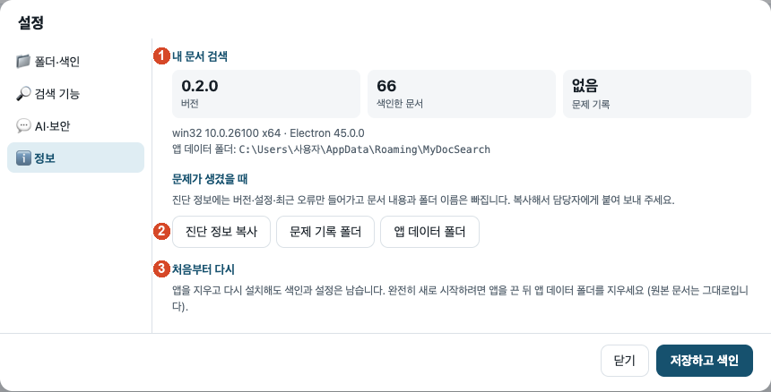

1. **내 문서 검색**: 버전, 색인한 문서 수, 문제 기록 수, 앱 데이터 폴더 위치.
2. **문제가 생겼을 때**: **진단 정보 복사**를 눌러 담당자에게 붙여 보내 주세요 (버전·설정·최근 오류만, 문서 내용과 폴더 이름은 빠짐). **문제 기록 폴더**·**앱 데이터 폴더**로 바로 갈 수 있습니다.
3. **처음부터 다시**: 앱을 끈 뒤 앱 데이터 폴더(`%APPDATA%\MyDocSearch`)를 지우면 색인·설정이 모두 지워집니다. 원본 문서는 그대로입니다.

### 다른 화면에 있는 설정

- **루틴 → ⚙ 설정 → 앱을 닫아도 실행**: 윈도우 작업 스케줄러가 15분마다 앱을 창 없이 깨워 바뀐 파일을 색인하고 때가 된 루틴을 돌립니다.
- **둘러보기 → 📈 아낀 시간**: 일마다 “1번에 아낀 시간(분)”을 회사 기준에 맞게 고칩니다.
- **AI에게 묻기**: 질문할 AI(Claude·ChatGPT)와 모델을 고릅니다. 큰 모델일수록 답이 좋지만 느리고 구독 사용량을 더 씁니다.

---

## 새 버전으로 바꾸기 · 지우기

- **새 버전**: 앱을 닫고 새 zip을 같은 폴더에 덮어 풉니다. 색인·설정·모음·루틴은 `%APPDATA%\MyDocSearch`에 있어 그대로 남습니다.
- **완전히 지우기**: 앱 폴더와 `%APPDATA%\MyDocSearch`를 지웁니다. 원본 문서는 건드리지 않습니다.
- **문제가 생겼을 때**: 설정 → ℹ️ 정보 → **진단 정보 복사**를 눌러 보내 주세요. 버전·설정 요약·최근 오류만 담기고 문서 내용과 폴더 이름은 빠집니다.

## 개인 정보

- 검색 색인과 설정은 이 PC의 `%APPDATA%\MyDocSearch`에만 저장됩니다. 앱은 원본 파일을 옮기거나 지우지 않습니다.
- AI에게 묻기를 쓸 때만 질문과 AI가 읽은 문서 일부가 고른 AI 서비스(Anthropic·OpenAI)로 갑니다. 보낸 내역은 둘러보기 → AI 전송 내역에서 봅니다.
- 사용 통계·원격 수집은 없습니다. 인터넷은 선택 기능에서만 씁니다: 의미 검색 모델 받기(Hugging Face), AI 로그인·답(Anthropic·OpenAI), 노션 연결(켰을 때).
